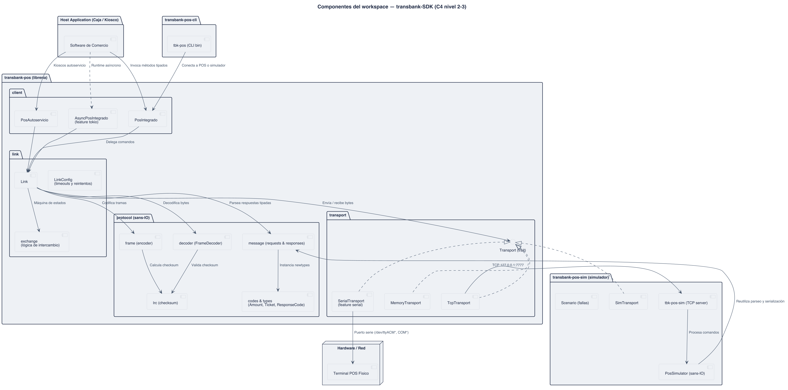

# transbank-SDK

SDK **no oficial** en Rust para comunicarse con los terminales **POS de Transbank** (Chile) conectados por USB o puerto serie: **POS Integrado** (Verifone VX520/VX520c, Ingenico Desk 3500) y **POS Autoservicio**. Implementa el protocolo serial (tramas STX/ETX/LRC, ACK/NAK, reintentos) e incluye un **simulador de POS** sans-IO con servidor TCP y una **CLI** para pruebas sin hardware.

> ⚠️ **Proyecto no oficial.** No está afiliado, respaldado ni soportado por Transbank S.A. El protocolo se derivó de los [SDKs oficiales de Transbank](https://github.com/TransbankDevelopers) (licencia BSD-3-Clause; ver [`NOTICE`](NOTICE)). Úsalo bajo tu responsabilidad y valida siempre con tu terminal antes de procesar transacciones reales de cobro.

---

## Qué es y para quién

Una solución moderna, segura y sin dependencias pesadas para desarrolladores e integradores que necesitan cobrar con tarjeta en puntos de venta en Chile. Diseñado específicamente para:
- **Software de punto de venta (POS) y cajas registradoras:** aplicaciones de escritorio (ej. [rework-sistema-facturacion](https://github.com/Demiannnnnn/rework-sistema-facturacion) en Tauri/Rust), kioscos de autoservicio y terminales de autoservicio.
- **Entornos desatendidos:** máquinas de autoservicio que se comunican a 19200 baudios y requieren control directo del comprobante.
- **Pruebas y desarrollo continuo:** desarrollo ágil sin necesidad de hardware físico mediante un simulador configurable y transparente al código de negocio.

---

## Características principales

- **Arquitectura sans-IO (ADR-01):** protocolo desacoplado de la entrada/salida y del reloj. La codificación, decodificación por máquina de estados, validación de LRC y parseo de payloads son funciones puras, deterministas y completamente testeables.
- **Enlace robusto (`Link<T>`):** manejo estricto de tramas serie con delimitadores `STX`/`ETX` y checksum `LRC`, acuse de recibo con `ACK`/`NAK`, hasta 3 reintentos automáticos de tramas no acusadas y control configurable de tiempos de espera (`ack_timeout`, `response_timeout`, `detail_tail`).
- **Regla de oro — Nunca doble cobro (ADR-04, LINK-03):** jamás se reenvía una venta o anulación tras haber recibido el `ACK` del terminal. Ante desconexión o expiración del tiempo de respuesta, el resultado se clasifica como desconocido y la API guía a conciliar mediante `last_sale()`.
- **Rechazo financiero ≠ Error de protocolo (ADR-03):** una tarjeta rechazada por saldo insuficiente o clave errónea es un resultado de negocio esperado (`Ok(SaleResponse)` con `is_approved() == false`). Los errores `Err(Error)` se reservan exclusivamente para fallos de comunicación, corrupción de tramas o timeouts.
- **POS Integrado y POS Autoservicio:** soporte completo para ambos modelos con clientes tipados `PosIntegrado` (115200 baudios) y `PosAutoservicio` (19200 baudios).
- **API asíncrona opcional (ASYNC-01):** clientes `AsyncLink` y `AsyncPosIntegrado` bajo la feature `tokio` (con soporte de puerto serie mediante `tokio-serial`).
- **Simulador sans-IO y servidor TCP (`transbank-pos-sim`):** biblioteca de simulación de terminales con inyección de escenarios de falla (LRC corrupto, NAK, timeouts) y binario servidor TCP (`tbk-pos-sim`).
- **Línea de comandos (`transbank-pos-cli` / `tbk-pos`):** binario completo para listar puertos, inicializar llaves, cobrar, anular, consultar última venta, obtener totales y ejecutar diagnósticos interactivos o automatizados con `--json`.
- **Cero código inseguro:** `#![forbid(unsafe_code)]` en todo el workspace, sin `unwrap()`, `expect()` ni `panic!` en código de producción, y validación estricta de dominios numéricos (`Amount`, `Ticket`, `OperationNumber`).
- **Protección de datos (PCI / Ley 19.628 / 21.719):** el SDK nunca maneja números de tarjeta completos (PAN) ni claves; además, las representaciones `Debug` y las trazas enmascaran automáticamente números de cuenta y vouchers.

---

## Estado actual

- **Versión del workspace:** `1.0.0` (aditiva en desarrollo activo).
- **Cobertura y suites:** 405 pruebas automáticas pasando en verde (pruebas unitarias sans-IO, fixtures reales byte a byte de SDKs oficiales, pruebas de propiedades con `proptest`, pruebas deterministas con reloj simulado y pruebas de integración cliente ↔ simulador).
- **Validación física (HW-01):** pendiente de validación en hardware real por el dueño del repositorio ([`docs/md/hardware-testing.md`](docs/md/hardware-testing.md)).

---

## Arquitectura



El workspace Cargo está compuesto por tres crates con responsabilidades estrictamente separadas:
1. **`transbank-pos`** (librería principal): protocolo sans-IO, máquina de estados del enlace, clientes tipados y abstracciones de transporte (`MemoryTransport`, `TcpTransport`, `SerialTransport`).
2. **`transbank-pos-sim`** (librería y binario `tbk-pos-sim`): emulador de terminal POS para pruebas de integración y desarrollo desconectado.
3. **`transbank-pos-cli`** (binario `tbk-pos`): interfaz de terminal para operación directa y scripts de diagnóstico.

---

## Stack tecnológico

| Componente | Versión exacta | Justificación / Propósito |
|:--|:--|:--|
| **Rust** | `1.85+` (edición 2024) | Compilación estricta sin runtime obligatorio, seguridad de memoria y rendimiento |
| **thiserror** | `2.0` | Definición idiomática y sin asignaciones dinámicas de errores tipados en la librería |
| **serialport** | `4.7` | Acceso multiplataforma a puertos serie y enumeración USB CDC-ACM (feature `serial`) |
| **serde** | `1.0` | Derivación opcional de serialización/deserialización para tipos y respuestas (feature `serde`) |
| **tracing** | `0.1` | Instrumentación estructurada de eventos de enlace sin comprometer datos confidenciales (feature `tracing`) |
| **clap** | `4.5` | Procesamiento robusto de argumentos en la CLI y el simulador TCP con derivación estricta |
| **serde_json** | `1.0` | Emisión de resultados en formato JSON para la CLI y pruebas de la feature `serde` |
| **tracing-subscriber** | `0.3` | Consumo y formateo de trazas en consola o archivo para la CLI |
| **proptest** | `1.6` | Pruebas de propiedades para verificar decodificación y parseo frente a bytes aleatorios |
| **tokio** | `1.43` | Soporte asíncrono opcional en `transbank_pos::tokio` (feature `tokio`) |
| **tokio-serial** | `5.4` | Integración asíncrona de puertos serie con Tokio (feature `tokio-serial`) |

---

## Requisitos del sistema

- **Compilador:** Rust estable **≥ 1.85** con `cargo`, `rustfmt` y `clippy`.
- **Linux:** paquetes de desarrollo de udev para el listado de puertos USB (`libudev-dev` en Debian/Ubuntu, `systemd-libs` en Fedora/Arch) y permisos de lectura/escritura sobre el puerto serie (usuario perteneciente a los grupos `dialout` o `uucp`).
- **macOS / Windows:** sin dependencias del sistema adicionales. Los puertos serie USB se reconocen como `/dev/cu.usbmodem*` o `COM*`.
- **Herramientas de documentación:** `plantuml` (con OpenJDK y Graphviz `dot`), `tectonic` y `pandoc` para regenerar diagramas e informes (`docs/build-docs.sh`).

---

## Instalación y arranque local

Clonar el repositorio y compilar el workspace completo:

```bash
git clone https://github.com/Demiannnnnn/transbank-SDK.git
cd transbank-SDK

# Compilar todos los crates en modo debug
cargo build --workspace

# Ejecutar la batería completa de 405 tests
cargo test --workspace --all-features
```

### Ejecución con el simulador local (sin hardware)

En una terminal, iniciar el simulador TCP:
```bash
cargo run -p transbank-pos-sim -- --listen 127.0.0.1:7777
```

En otra terminal, operar contra el simulador usando la CLI:
```bash
# Verificar conexión (poll)
cargo run -p transbank-pos-cli -- --tcp 127.0.0.1:7777 poll

# Cargar llaves criptográficas
cargo run -p transbank-pos-cli -- --tcp 127.0.0.1:7777 load-keys

# Realizar una venta simulada de $15.000 (ticket BOL101)
cargo run -p transbank-pos-cli -- --tcp 127.0.0.1:7777 sale 15000 BOL101

# Consultar totales acumulados de la jornada
cargo run -p transbank-pos-cli -- --tcp 127.0.0.1:7777 totals
```

### Ejecución directa en memoria con la CLI

Para demostraciones rápidas o pruebas unitarias en scripts sin abrir puertos de red:
```bash
cargo run -p transbank-pos-cli -- --sim sale 12000 DEMO01
```

---

## Configuración y variables

### Variables de entorno

| Variable | Descripción | Valor por defecto |
|:--|:--|:--|
| `RUST_LOG` | Filtro de bitácora de `tracing` (ej. `info`, `debug`, `transbank_pos::link=trace`) | Vacío / desactivado |
| `PLANTUML` | Ruta personalizada al binario de PlantUML para compilar diagramas | `/Users/demian/Documents/Github/_sii/orch/bin/plantuml` o `plantuml` en PATH |

### Argumentos principales de la CLI (`tbk-pos`)

| Opción / Flag | Descripción |
|:--|:--|
| `--port <PATH>` | Ruta al dispositivo serie (ej. `/dev/ttyACM0` o `COM3`) |
| `--baud <RATE>` | Velocidad en baudios (por defecto `115200` para Integrado, `19200` con `--autoservicio`) |
| `--tcp <ADDR>` | Dirección del puente serie o simulador TCP (ej. `127.0.0.1:7777`) |
| `--sim` | Ejecuta la operación contra un simulador en memoria (sin hardware ni red) |
| `--autoservicio` | Modula la comunicación para el protocolo de POS Autoservicio |
| `--json` | Genera la salida de respuesta en formato JSON estructurado |
| `--trace-file <PATH>` | Registra trazas completas y redactadas en el archivo especificado |
| `--show-voucher` | Incluye el texto íntegro del comprobante en la salida JSON |
| `--yes`, `-y` | Omite confirmaciones interactivas en operaciones destructivas (cierre, anulación) |

---

## Ejemplos de uso

### 1. Cobro síncrono con POS Integrado (`transbank-pos`)

```rust
use transbank_pos::{
    serial::SerialTransport,
    Amount, IntermediateStatus, PosIntegrado, Result, SaleRequest, Ticket,
};

fn main() -> Result<()> {
    // 1. Abrir puerto serie (115200 baudios, 8N1)
    let transport = SerialTransport::open("/dev/ttyACM0", 115_200)?;
    let mut pos = PosIntegrado::new(transport);

    // 2. Comprobar que el terminal responde
    pos.poll()?;
    println!("POS conectado y listo.");

    // 3. Preparar solicitud de venta ($25.000, boleta BOL-9081)
    let request = SaleRequest::new(25_000, "B9081")?.with_voucher(true);

    // 4. Iniciar venta recibiendo estados en tiempo real (0900)
    let sale = pos.sale_with_status(&request, |status: IntermediateStatus| {
        println!("Estado del POS: {}", status.message());
    })?;

    // 5. Evaluar resultado de negocio
    if sale.is_approved() {
        println!("Pago Aprobado!");
        println!("Código Autorización: {:?}", sale.authorization_code);
        println!("Últimos 4 dígitos: {:?}", sale.last4_digits);
        println!("Operación POS N°: {:?}", sale.operation_number);
    } else {
        println!("Pago Rechazado: {}", sale.response_code.message());
    }

    Ok(())
}
```

### 2. Cobro asíncrono con Tokio (feature `tokio`)

```rust
#[cfg(feature = "tokio")]
use transbank_pos::tokio::AsyncPosIntegrado;

#[tokio::main]
async fn main() -> Result<(), Box<dyn std::error::Error>> {
    // Conexión TCP asíncrona hacia simulador o puente serie
    let mut pos = AsyncPosIntegrado::connect_tcp("127.0.0.1:7777").await?;
    pos.poll().await?;

    let req = transbank_pos::SaleRequest::new(10_000, "TK100")?;
    let resp = pos.sale(&req).await?;

    println!("Aprobado: {}", resp.is_approved());
    Ok(())
}
```

---

## API pública

La API pública de `transbank-pos` está completamente tipada, garantizada por `#![forbid(unsafe_code)]` y documentada con denegación estricta de documentación faltante (`missing_docs = "deny"`):

- **Tipos de datos validados:** `Amount` (50 a 999.999.999 CLP), `Ticket` (hasta 6 caracteres alfanuméricos ASCII), `OperationNumber` (1 a 999.999) y `CommerceCode`.
- **Clientes principales:** `PosIntegrado<T, C>` y `PosAutoservicio<T, C>` son genéricos sobre el canal `Transport` y la fuente de tiempo `Clock`, facilitando pruebas con reloj manual (`ManualClock`).
- **Transportes disponibles:**
  - `SerialTransport`: comunicación serie nativa 8N1 sin control de flujo por hardware ni software.
  - `TcpTransport`: comunicación mediante sockets TCP para puentes serial-a-red y simulador.
  - `MemoryTransport`: canal en memoria con respuestas programadas para tests deterministas.
- **Redacción de privacidad:** implementaciones de `fmt::Debug` y eventos de `tracing` enmascaran automáticamente `account_number` (conservando solo el largo) y el contenido del `voucher`.

El contrato normativo completo de la API se detalla en [`.ai-context/public-api.md`](.ai-context/public-api.md).

---

## Pruebas y verificación

El proyecto implementa una rigurosa pirámide de pruebas sin llamadas de red externa, sin puertos serie reales y sin retardos arbitrarios (`thread::sleep`):

```bash
# 1. Verificación de formato
cargo fmt --all --check

# 2. Análisis estático (linter) en modo estricto
cargo clippy --workspace --all-targets --all-features -- -D warnings

# 3. Compilación mínima sin features por defecto
cargo clippy -p transbank-pos --no-default-features -- -D warnings

# 4. Batería completa de pruebas (unitarias, integración, proptest)
cargo test --workspace --all-features

# 5. Documentación de API sin enlaces rotos ni warnings
RUSTDOCFLAGS="-D warnings" cargo doc --workspace --no-deps --all-features

# 6. Comprobación de documentación para humanos (diagramas e informes)
docs/build-docs.sh --check
```

---

## Estructura del repositorio

```
transbank-SDK/
├── Cargo.toml                     # Manifiesto del workspace Cargo (MSRV 1.85, edición 2024)
├── Cargo.lock                     # Dependencias versionadas de forma determinista
├── clippy.toml                    # Configuración estricta de lints para producción y tests
├── rustfmt.toml                   # Estilo de código Rust 2024
├── LICENSE-MIT                    # Licencia MIT
├── LICENSE-APACHE                 # Licencia Apache 2.0
├── NOTICE                         # Atribución legal a SDKs oficiales de Transbank (BSD-3)
├── README.md                      # Presentación e índice general
├── CHANGELOG.md                   # Registro histórico de versiones y cambios
├── AGENTS.md                      # Reglas obligatorias para desarrollo y mantenimiento
├── CLAUDE.md                      # Guía del orquestador de agentes
├── .ai-context/                   # Contexto normativo para agentes de IA
│   ├── README.md                  # Mapa y orden de lectura
│   ├── domain.md                  # Dominio de pagos con POS, actores y reglas de negocio
│   ├── architecture.md            # Arquitectura del workspace, capas y decisiones (ADR)
│   ├── constraints.md             # Restricciones duras con identificador (PROTO, LINK, SEC...)
│   ├── conventions.md             # Convenciones de estilo, ramas y commits
│   ├── security-model.md          # Modelo de amenazas, redacción de datos y auditoría
│   ├── public-api.md              # Contrato público de firmas y tipos
│   ├── implementation-status.md   # Estado real de componentes frente a lo planificado
│   ├── handoff.md                 # Bitácora de transición y continuidad del proyecto
│   └── docs-standard.md           # Estándar de documentación para humanos del ecosistema
├── docs/                          # Documentación para humanos y técnica
│   ├── build-docs.sh              # Script unificado para regenerar diagramas e informes
│   ├── plantilla/                 # Clase LaTeX, estilo PlantUML y filtros Pandoc
│   ├── diagramas/                 # Fuentes .puml y salidas compiladas .svg y .png
│   │   ├── fuentes/               # 8 diagramas fuente (C4, secuencias, flujo, estados)
│   │   ├── svg/                   # Diagramas vectoriales SVG generados
│   │   └── png/                   # Diagramas rasterizados PNG generados
│   ├── informes/                  # Informes técnicos, legales y operativos compilados
│   │   ├── informe-tecnico/       # Informe técnico exhaustivo (.tex, .pdf, .docx)
│   │   ├── informe-diagramas/     # Informe detallado de diagramas (.tex, .pdf, .docx)
│   │   ├── informe-legal/         # Informe de cumplimiento legal chileno (.tex, .pdf, .docx)
│   │   ├── informe-seguridad/     # Informe de seguridad y modelo STRIDE (.tex, .pdf, .docx)
│   │   ├── guia-integracion/      # Guía de integración para desarrolladores (.tex, .pdf, .docx)
│   │   └── informe-pruebas/       # Informe de pruebas y cobertura real (.tex, .pdf, .docx)
│   └── md/                        # Especificaciones técnicas normativas en Markdown
│       ├── protocol-spec.md       # Especificación del protocolo serie Transbank
│       ├── simulator-spec.md      # Especificación del simulador de terminales
│       ├── hardware-testing.md    # Guía de validación manual en POS físico
│       ├── release-prep-2026-11.md# Registro de auditoría previa a release
│       └── release.md             # Procedimiento de empaquetado y publicación
├── tasks/                         # Plan maestro de tareas (historias de desarrollo)
├── tools/orchestration/           # Scripts auxiliares de canalización de tareas
└── crates/
    ├── transbank-pos/             # Librería central (protocolo, enlace, clientes)
    ├── transbank-pos-sim/         # Simulador sans-IO y servidor TCP tbk-pos-sim
    └── transbank-pos-cli/         # Aplicación de terminal tbk-pos
```

---

## Documentación

### Especificaciones técnicas normativas (Markdown)

| Documento | Descripción | Enlace |
|:--|:--|:--|
| **Especificación del protocolo serial** | Tramas, bytes exactos, comandos, campos y códigos de respuesta | [`docs/md/protocol-spec.md`](docs/md/protocol-spec.md) |
| **Especificación del simulador** | Comportamiento, escenarios de inyección de fallas y servidor TCP | [`docs/md/simulator-spec.md`](docs/md/simulator-spec.md) |
| **Pruebas en hardware real** | Protocolo de pruebas físicas con terminales Verifone e Ingenico | [`docs/md/hardware-testing.md`](docs/md/hardware-testing.md) |
| **Auditoría de protocolo** | Hallazgos cruzados con los SDKs oficiales de Transbank | [`docs/md/release-prep-2026-11.md`](docs/md/release-prep-2026-11.md) |
| **Guía de publicación** | Procedimiento de release en crates.io y verificación de empaquetado | [`docs/md/release.md`](docs/md/release.md) |

### Informes formales para humanos (PDF / DOCX)

Documentación completa generada con el estándar común del ecosistema, con control de versiones, índices formales y diagramas a página completa:

| Informe | Descripción | PDF | DOCX |
|:--|:--|:--:|:--:|
| **Informe Técnico** | Arquitectura exhaustiva, módulos, algoritmos, stack y deuda técnica | [PDF](docs/informes/informe-tecnico/informe-tecnico.pdf) | [DOCX](docs/informes/informe-tecnico/informe-tecnico.docx) |
| **Informe de Diagramas** | Catálogo visual completo con explicaciones paso a paso de cada flujo | [PDF](docs/informes/informe-diagramas/informe-diagramas.pdf) | [DOCX](docs/informes/informe-diagramas/informe-diagramas.docx) |
| **Informe Legal** | Matriz de cumplimiento normativo chileno (Leyes 19.628, 21.719, 21.663, PCI) | [PDF](docs/informes/informe-legal/informe-legal.pdf) | [DOCX](docs/informes/informe-legal/informe-legal.docx) |
| **Informe de Seguridad** | Modelo de amenazas STRIDE, superficies de ataque y controles implementados | [PDF](docs/informes/informe-seguridad/informe-seguridad.pdf) | [DOCX](docs/informes/informe-seguridad/informe-seguridad.docx) |
| **Guía de Integración** | Manual paso a paso para desarrolladores, manejo de errores y ejemplos | [PDF](docs/informes/guia-integracion/guia-integracion.pdf) | [DOCX](docs/informes/guia-integracion/guia-integracion.docx) |
| **Informe de Pruebas** | Estrategia de testing, métricas reales de cobertura y suites de integración | [PDF](docs/informes/informe-pruebas/informe-pruebas.pdf) | [DOCX](docs/informes/informe-pruebas/informe-pruebas.docx) |

---

## Cumplimiento legal y normativo

- **Aislamiento PCI-DSS:** el software host que integra `transbank-pos` queda fuera del alcance estricto de PCI-DSS para captura de tarjetas, ya que el terminal POS físico procesa el chip/banda, solicita el PIN en su PIN pad cifrado y se comunica directamente con Transbank.
- **Protección de Datos Personales (Ley N° 19.628 y Ley N° 21.719):** el SDK cumple con el principio de minimización de datos. Jamás captura ni almacena el número de cuenta completo (PAN), fecha de caducidad ni código de seguridad (CVV). Solo procesa los últimos 4 dígitos entregados por el voucher comercial.
- **Ley Marco de Ciberseguridad (Ley N° 21.663):** trazabilidad sin filtración de secretos, descarte activo de tramas malformadas y mitigación contra estados inconsistentes o cobros no acusados.
- **Aviso:** la documentación técnica y legal de este repositorio es de carácter informativo para ingenieros y auditores y no constituye asesoría legal vinculante.

---

## Seguridad

Si identificas una vulnerabilidad o defecto de seguridad en este repositorio:
1. No abras un issue público de inmediato.
2. Reporta el caso directamente al mantenedor o creador del proyecto.
3. El proyecto garantiza redacción automática de datos sensibles en bitácoras (`Debug` y `tracing`), descarte de paquetes maliciosos fuera de trama y ejecución sin permisos elevados de sistema operativo.

---

## Licencia

Distribuido a tu elección bajo cualquiera de las siguientes dos licencias:
- **Licencia Apache, Versión 2.0** ([`LICENSE-APACHE`](LICENSE-APACHE) o http://www.apache.org/licenses/LICENSE-2.0)
- **Licencia MIT** ([`LICENSE-MIT`](LICENSE-MIT) o http://opensource.org/licenses/MIT)

Las partes derivadas de los SDKs oficiales de Transbank conservan su licencia original BSD de 3 cláusulas, detallada en el archivo [`NOTICE`](NOTICE).

---

## Relación con el ecosistema raysac

`transbank-SDK` forma parte del ecosistema de software libre y aplicaciones de escritorio de raysac:
- **`rework-sistema-facturacion`:** aplicación de escritorio multiplataforma (Tauri / Rust) para emisión de boletas y control de inventario en comercios chilenos, que consume `transbank-pos` para resolver los cobros presenciales con tarjeta.
- **`sii-sdk`:** biblioteca en Rust para la firma electrónica XML, generación de timbre electrónico (TED) y envío de Documentos Tributarios Electrónicos (DTE) al Servicio de Impuestos Internos (SII).
